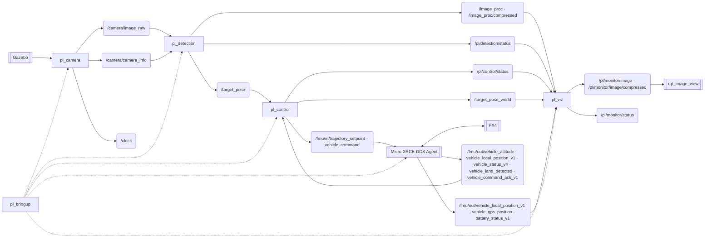
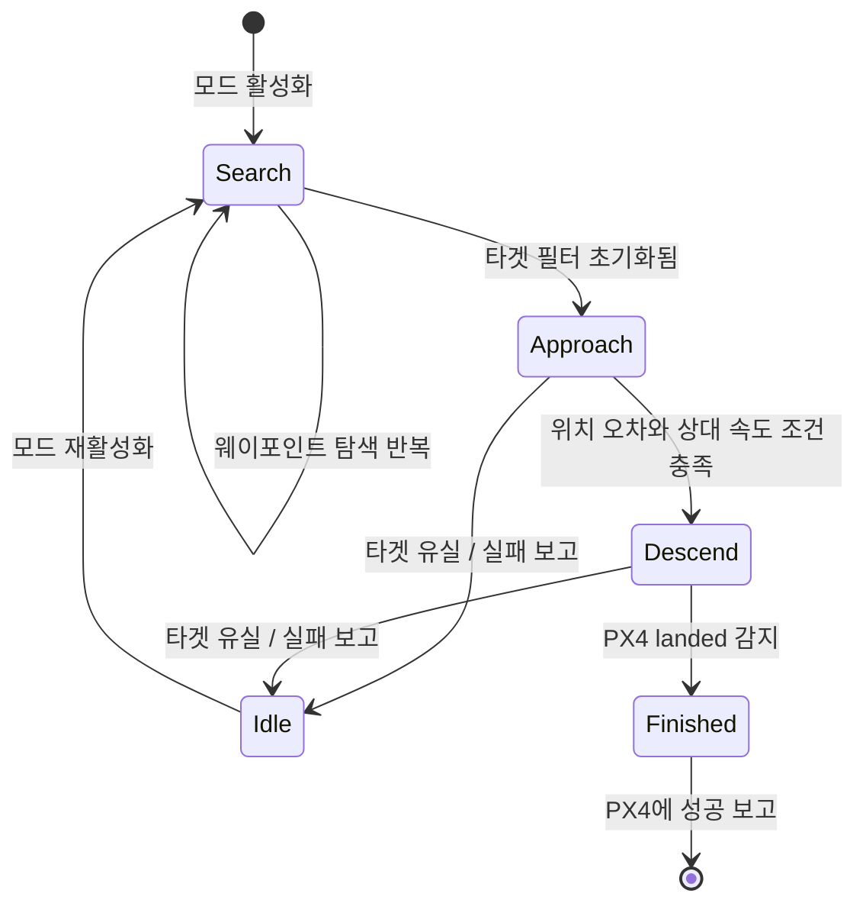

# Precision Landing

## 1. 시스템 개요

하향 카메라로 ArUco 마커를 인식하고, 정지하거나 이동하는 타겟에 착륙하는 ROS 2 기반 시스템입니다.

- **인식:** 마커 코너와 카메라 보정값으로 상대 위치·자세 계산.
- **추정:** NED 좌표계에서 타겟 위치·속도를 등속도 칼만 필터로 추정.
- **제어:** PX4 외부 모드 `PrecisionLandCustom`에서 탐색 → 접근 → 하강 → 착륙 완료.
- **모니터링:** 영상 위에 FSM, GPS, 속도, 배터리, 중심 십자와 마커 방향 화살표 표시.
- **실행 환경:** Gazebo SITL과 실기체용 프로파일 제공. CSI 입력과 실기체 검증은 보류.
- **검증 범위:** 기존 PX4 조합의 정지·이동 착륙 및 QGC 동작 확인. 공통 모니터 추가 후 빌드·ROS 통합 테스트는 통과했으며, 해당 구성의 SITL 비행 재검증은 대기 중.

## 2. 요구사항

| 항목 | 기준 / 용도 |
|---|---|
| Linux | Ubuntu 22.04 |
| ROS 2 | Humble; `colcon`, `ament_cmake`, `ament_python` |
| Gazebo | Harmonic; SITL 전용 |
| PX4 | 기존 `~/PX4-Autopilot`, 검증 커밋 `ee99864808e03c164975fc38c450fa22179fe0cb`; `PX4_DIR`로 경로 변경 |
| PX4 빌드 환경 | PX4 SITL 빌드 도구·의존성 사전 설치; 기존 체크아웃과 사용자 모델 유지 |
| Micro XRCE-DDS Agent | `MicroXRCEAgent` 실행 파일; SITL UDP 8888, 실기체 UART |
| QGroundControl | 수동 이륙·모드 선택 시 사용; 자동 시험은 `scripts/test_flight.py` |
| Python | 3.10, pip |
| NumPy / OpenCV | `numpy==1.26.4`, `opencv-contrib-python-headless==4.10.0.84`; setup이 `.deps/python`에 설치 |
| px4_msgs | ROS 메시지 서브모듈; `d3673f41976f04c64a5e559a61a441f348501913` |
| px4-ros2-interface-lib | PX4 모드·setpoint 연동 서브모듈; `7338c1df755c20902dc65d5b844f347d877b5268` |
| ros_gz | 카메라·시뮬 시간 브리지 서브모듈; SITL 전용 |
| Gazebo 개발 라이브러리 | `gz-transport13`, `gz-msgs10`; 선택적 Gazebo 마커 표시 빌드에 사용 |
| 추가 ROS 도구 | `rqt_image_view`, `rosbag2`, `gps_msgs`; setup이 SITL용 `gps_msgs`를 `.deps/apt`에 준비 |
| Python 시험 도구 | `pytest`; 자동 비행 시험은 `pymavlink`도 사용 |
| 실기체 카메라 | 보정된 `Image`·`CameraInfo`, optical frame 및 기체 장착 변환 필요; CSI 드라이버 구현 보류 |

## 3. 노드 구조

사각형은 패키지, 둥근 사각형은 토픽입니다. 외부 프로그램은 이중 사각형으로 표시합니다.
`pl_bringup`의 점선은 실행 관계이며 데이터 전송이 아닙니다.



모드 등록·arming check 등 `px4_ros2_cpp` 내부 통신은 생략했습니다. `/pl/start_landing`은 토픽이 아닌 `std_srvs/Trigger` 서비스입니다. `/target_pose_world`는 선택적 Gazebo 마커 노드에서 사용합니다.

| 패키지 | 실행 노드 / 역할 |
|---|---|
| `pl_camera` | `camera_bridge`, `debug_image_bridge`: Gazebo 영상·보정값·시계 연결, 디버그 영상의 선택적 역방향 브리지 |
| `pl_detection` | `aruco_tracker`: ArUco 인식, optical 좌표 pose, 마커 윤곽·화살표 및 검출 상태 발행 |
| `pl_control` | `precision_land`: PX4 외부 모드, KF, 착륙 FSM, setpoint 및 제어 상태 발행 |
| `pl_viz` | `landing_monitor`: 공통 영상 오버레이; `tag_pose_visualizer`: 선택적 Gazebo 마커 표시 |
| `pl_bringup` | 자체 처리 노드 없이 환경별 설정·launch 제공; Agent를 한 번만 실행 |
| `px4_msgs` | PX4 ROS 메시지 정의 |
| `px4_ros2_cpp` | `px4-ros2-interface-lib`가 제공하는 모드 등록·기체 상태·setpoint 인터페이스 |
| `ros_gz_bridge` | `ros_gz`가 제공하는 Gazebo ↔ ROS 메시지 변환 |

## 4. 착륙 FSM



| 단계 | 알고리즘 / 전이 조건 |
|---|---|
| `Idle` | 제어 갱신 없음. 타겟 유실 실패 후 진입 |
| `Search` | NED 원점 XY 기준 반경 최대 2 m의 나선형 웨이포인트 탐색. 높이 간격 0.5 m. 필터가 초기화되면 접근 시작 |
| `Approach` | 진입 고도를 유지하며 XY 속도로 타겟 추종. 위치 오차와 기체−타겟 상대 속도가 임계값보다 작으면 하강 |
| `Descend` | XY 추종을 유지하며 일정 수직 속도로 하강. 마커 자세에서 yaw 지정. PX4 착륙 감지 시 완료 |
| `Finished` | PX4 모드 실행 결과를 성공으로 보고 |

- FSM은 **5단계**. 화면의 `INACTIVE`는 별도 단계가 아니라 외부 모드 비활성 표시.
- 색상: 대기 회색, 탐색·접근·하강 노란색, 완료 초록색. 활성 중 타겟 유실 또는 제어 상태 수신 이상은 빨간색 우선.
- 수동 모드 전환 시 외부 모드가 비활성화됨. `Idle` 자체가 Hold/자동 착륙 명령을 보내는 것은 아님.

## 5. 상태 추정 및 제어

### 5.1 마커 관측과 좌표 변환

- ArUco 코너 검출 → 왜곡 보정 → iterative `solvePnP`로 카메라 기준 마커 pose 계산.
- 카메라 optical: **X 오른쪽, Y 아래, Z 전방**.
- 기체 FRD: **X 전방, Y 오른쪽, Z 아래**. 제어 좌표 NED: **북·동·아래**.
- 장착 변환과 기체 pose를 합성:

$$
T_{N,M}=T_{N,B}\,T_{B,C}\,T_{C,M}
$$

- $T_{A,B}$: B 좌표를 A 좌표로 옮기는 변환. N: NED, B: 기체, C: 카메라, M: 마커.
- 장착 설정: `camera_position_body`, `camera_orientation_body`(w, x, y, z).

### 5.2 타겟 위치·속도 추정

- 상태: $\mathbf{x}=[\mathbf{p}_t^T,\mathbf{v}_t^T]^T$; 관측은 NED 위치 $\mathbf{z}$만 사용.
- **등속도 예측:** 제어 tick마다 실행. 짧은 미검출 구간에도 타겟 위치 예측 지속.

$$
F=\begin{bmatrix}I&\Delta t I\\0&I\end{bmatrix},\quad
\hat{\mathbf{x}}^-=F\hat{\mathbf{x}},\quad P^-=FPF^T+Q
$$

$$
Q=\sigma_a^2\begin{bmatrix}\frac{\Delta t^4}{4}I&\frac{\Delta t^3}{2}I\\\frac{\Delta t^3}{2}I&\Delta t^2 I\end{bmatrix}
$$

- **관측 보정:** 새 마커 pose를 받을 때 실행.

$$
H=[I\;0],\quad R=\sigma_p^2 I,\quad K=P^-H^T(HP^-H^T+R)^{-1}
$$

$$
\hat{\mathbf{x}}=\hat{\mathbf{x}}^-+K(\mathbf{z}-H\hat{\mathbf{x}}^-),\quad P=(I-KH)P^-
$$

- 초기값: 위치는 첫 관측, 속도는 0; $P_{pp}=\sigma_p^2I$, $P_{vv}=4I$.
- 기본값: $\sigma_a=1.0\;\mathrm{m/s^2}$, $\sigma_p=0.1\;\mathrm{m}$.
- 마커 자세는 KF 상태에 포함하지 않고 관측값 사용.
- **현재 제한:** 수신 시점의 기체 pose로 변환하며 유실 시간도 수신 시점 기준. 촬영 시각 보간·Delayed KF·모드 재진입 시 추정 초기화는 [5번 계획](docs/refactor_plan.md)의 후속 작업.

### 5.3 수평 추종·하강 제어

- 위치 오차: $\mathbf{e}_{xy}=\mathbf{p}_{vehicle,xy}-\hat{\mathbf{p}}_{target,xy}$.
- **타겟 속도 feedforward + PI 보정**, 축별 속도 제한:

$$
\mathbf{I}_k=\operatorname{clip}(\mathbf{I}_{k-1}+\mathbf{e}_{xy,k},-v_{max},v_{max})
$$

$$
\mathbf{v}_{cmd,xy}=\operatorname{clip}(\hat{\mathbf{v}}_{target,xy}-K_p\mathbf{e}_{xy}-K_i\mathbf{I}_k,-v_{max},v_{max})
$$

- 현재 적분 구현은 오차 누적이며 $\Delta t$를 곱하지 않음. 기본 $K_i=0$이므로 **P + feedforward**로 동작.
- 기본 설정: $K_p=1.7$, $v_{max}=10\;\mathrm{m/s}$, 하강 속도 $v_z=+0.6\;\mathrm{m/s}$.
- `Approach`: XY 속도 + 진입 시 Z 위치 유지. `Descend`: XYZ 속도 + 마커 yaw.
- 하강 진입 판정(3차원 norm, 목표 Z는 유지 고도):

$$
\|\mathbf{p}_{goal}-\mathbf{p}_{vehicle}\|<0.2\;\mathrm{m},\quad
\|\mathbf{v}_{vehicle}-\hat{\mathbf{v}}_{target}\|<0.2\;\mathrm{m/s}
$$

- 마지막 관측 수신 후 기본 **5초** 초과 시 타겟 유실. 접근·하강 중이면 실패 보고 후 `Idle`.
- 기본값은 [sim.yaml](src/pl_bringup/config/sim.yaml), 실기체 설정은 [hardware.yaml](src/pl_bringup/config/hardware.yaml).

## 6. 실행방법

### 6.1 간단 실행 — sh 사용

**최초 의존성 준비·빌드:** 요구사항의 ROS/Gazebo/PX4 도구와 Agent가 설치된 환경에서 실행합니다.

```bash
cd ~/precision-landing
export PX4_DIR="$HOME/PX4-Autopilot"
./scripts/setup.sh sim
```

`setup.sh`는 프로젝트 서브모듈·Python wheel을 준비하고 빌드합니다. 기존 PX4 커밋을 변경하거나 reset하지 않습니다. 이후 코드 수정 시 `./scripts/build.sh sim`으로 재빌드합니다.

**실행:** 다른 PX4/Agent를 종료한 뒤 실행합니다.

```bash
cd ~/precision-landing
./scripts/run.sh
```

- Gazebo, PX4 SITL, Agent, ROS 노드, 모니터 창 자동 실행.
- 기본 월드: `aruco_moving`, 마커 1 m. 타겟은 처음에 정지.
- 모니터 창을 닫아도 비행은 유지. 실행 터미널에서 `Ctrl+C`로 전체 종료.
- 로그: `.run/`. GUI 없이 실행: `HEADLESS=1 ./scripts/run.sh`.

**다른 터미널 — 자동 이륙·착륙 시험:**

```bash
cd ~/precision-landing
source scripts/env.sh
python3 scripts/test_flight.py             # 이동 타겟 0.3 m/s
# python3 scripts/test_flight.py --speed 0  # 정지 타겟
```

각 시험 전 시뮬을 새로 실행합니다. 시험은 이륙·모드 전환·타겟 이동·착륙·자동 disarm을 확인합니다.

**수동 시험:** QGC에서 이륙한 뒤 `PrecisionLandCustom`을 선택하거나 다음 서비스를 호출합니다. 서비스는 무장·이륙을 수행하지 않습니다.

```bash
source scripts/env.sh
export ROS_DOMAIN_ID=42
ros2 service call /pl/start_landing std_srvs/srv/Trigger '{}'
```

타겟 이동·정지:

```bash
./scripts/move_target.sh 0.3
./scripts/move_target.sh 0 0
```

### 6.2 터미널별 개별 실행

먼저 6.1의 빌드를 완료합니다. `run.sh`와 동시에 실행하지 않습니다.
**아래 공통 환경을 모든 터미널에서 먼저 실행**한 뒤, 각 터미널에 해당 명령을 입력합니다.

```bash
cd ~/precision-landing
export PX4_DIR="$HOME/PX4-Autopilot"
source scripts/env.sh
export ROS_DOMAIN_ID=42
export GZ_PARTITION=precision_landing
source "$PX4_DIR/build/px4_sitl_default/rootfs/gz_env.sh"
export PX4_GZ_MODELS="$PX4_DIR/Tools/simulation/gz/models"
export PX4_GZ_WORLDS="$PWD/simulation/gz/worlds"
```

**터미널 1 — Gazebo 월드와 GUI:**

```bash
gz sim -r "$PX4_GZ_WORLDS/aruco_moving.sdf"
```

**터미널 2 — PX4 SITL:** Gazebo가 열린 뒤 실행합니다.

```bash
mkdir -p "$PWD/.run/manual/px4-rootfs"
PX4_GZ_STANDALONE=1 PX4_SYS_AUTOSTART=4014 \
PX4_SIM_MODEL=gz_x500_mono_cam_down PX4_GZ_WORLD=aruco_moving GZ_IP=127.0.0.1 \
  "$PX4_DIR/build/px4_sitl_default/bin/px4" -d \
  "$PX4_DIR/build/px4_sitl_default/etc" -w "$PWD/.run/manual/px4-rootfs"
```

**터미널 3 — DDS Agent:** 한 인스턴스만 실행합니다.

```bash
MicroXRCEAgent udp4 -p 8888
```

**터미널 4 — 카메라·시간 브리지:**

```bash
ros2 launch pl_camera camera_sim.launch.py world:=aruco_moving
```

**터미널 5 — ArUco 인식:**

```bash
ros2 run pl_detection aruco_tracker --ros-args -r __node:=aruco_tracker \
  --params-file src/pl_detection/cfg/params.yaml
```

**터미널 6 — 착륙 제어:** PX4의 `Startup script returned successfully` 출력과 Agent 실행을 확인한 뒤 시작합니다.

```bash
ros2 run pl_control precision_land --ros-args -r __node:=precision_land \
  --params-file src/pl_control/cfg/params.yaml
```

**터미널 7 — 공통 모니터 합성:**

```bash
ros2 run pl_viz monitor
```

**터미널 8 — 영상 표시:**

```bash
ros2 run rqt_image_view rqt_image_view /pl/monitor/image
```

**선택 터미널 — Gazebo 마커 표시:**

```bash
ros2 run pl_viz tag_pose_visualizer
```

별도 터미널에서 6.1의 `test_flight.py` 또는 수동 모드 전환을 사용합니다. 개별 실행은 각 터미널에서 `Ctrl+C`로 종료합니다. `pl_bringup sim.launch.py`는 Agent까지 포함하므로 위 개별 실행과 중복 실행하지 않습니다.

실기체는 `./scripts/setup.sh hardware` 후 `ros2 launch pl_bringup hardware.launch.py`를 사용합니다. 카메라 보정·장착 확인 플래그와 UART 경로를 먼저 설정해야 하며, CSI 입력·실기체 검증은 보류 상태입니다.

세부 안내: [실행 환경](docs/run_local.md) · [카메라 입력](docs/camera_inputs_stage1.md) · [PX4 호환](docs/px4_compatibility_stage3.md) · [모니터링](docs/monitoring_stage4.md) · [리팩터링 계획](docs/refactor_plan.md)
