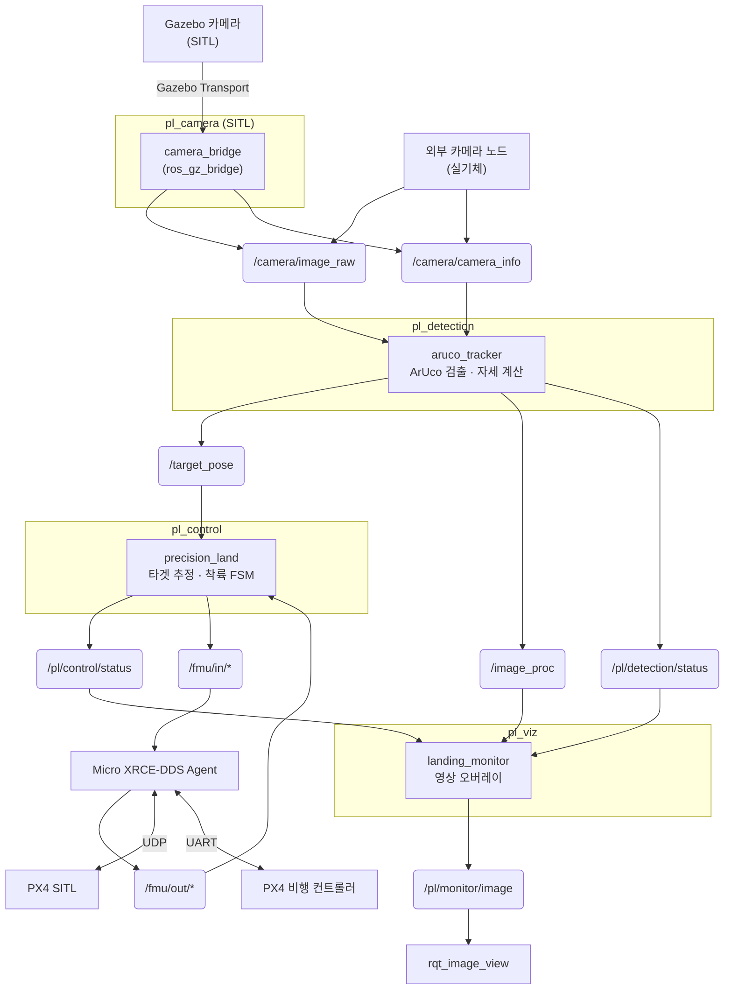
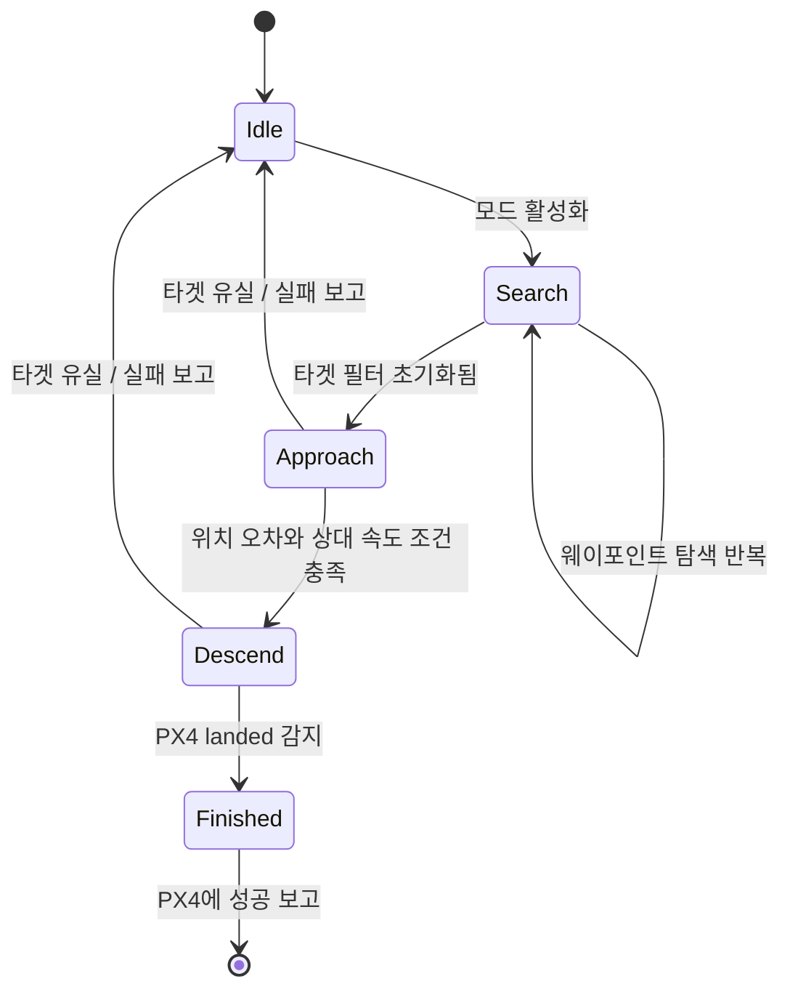
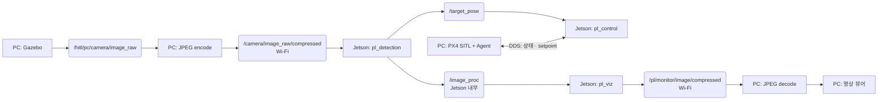

# Precision Landing

## 1. 시스템 개요

하향 카메라로 ArUco 마커를 인식하고, 정지하거나 이동하는 타겟에 착륙하는 ROS 2 기반 시스템

## 2. 요구사항

| 항목       | 기준 / 용도                                          |
| ---------- | ---------------------------------------------------- |
| OS         | Ubuntu 22.04                                         |
| ROS        | ROS 2 Humble                                         |
| 시뮬레이터 | Gazebo Harmonic                                      |
| PX4        | 검증 커밋 `ee99864808e03c164975fc38c450fa22179fe0cb` |

## 3. 노드 구조

큰 테두리는 패키지, 그 안의 각진 네모는 실행 노드, 둥근 네모는 ROS 토픽입니다. 기본 SITL과 실기체 프로파일의 주요 데이터 흐름을 표시합니다.



| 패키지 | 노드·실행 항목 | 역할 |
| --- | --- | --- |
| `pl_camera` | `camera_bridge`, `debug_image_bridge`, `image_relay` | Gazebo 영상·보정값·시계를 ROS로 연결하고, 디버그 영상 역방향 브리지와 HITL JPEG 변환을 제공 |
| `pl_detection` | `aruco_tracker` | ArUco 마커를 검출하고 카메라 기준 마커 자세, 디버그 영상, 검출 상태를 발행 |
| `pl_control` | `precision_land` | PX4 외부 모드에서 타겟 위치·속도를 추정하고, 착륙 FSM에 따라 setpoint와 제어 상태를 발행 |
| `pl_viz` | `landing_monitor`, `tag_pose_visualizer` | 인식 영상과 제어·비행 상태를 오버레이하고, SITL에서 선택적으로 Gazebo에 타겟 위치를 표시 |
| `pl_bringup` | SITL·실기체·HITL launch | 환경별 설정을 적용하고 ROS 노드와 DDS Agent의 실행을 구성 |
| `ros_gz_bridge` | `parameter_bridge` | Gazebo Transport와 ROS 2 메시지를 변환 |
| `px4_msgs` | 메시지 정의 | ROS 2와 PX4가 주고받는 메시지 타입을 제공 |
| `px4_ros2_cpp` | PX4 인터페이스 라이브러리 | 외부 모드 등록, 기체 상태 수신, setpoint 발행을 지원 |

실기체에서는 외부 카메라 노드가 보정된 영상과 카메라 정보를 발행합니다. CSI 드라이버 구현은 보류 중입니다.

## 4. 착륙 FSM



| 단계       | 알고리즘 / 전이 조건                                                                                  |
| ---------- | ----------------------------------------------------------------------------------------------------- |
| `Idle`     | 초기 대기 상태. 타겟 유실로 실패하면 복귀하며, 모드 활성화 시 탐색 시작                                  |
| `Search`   | NED 원점 XY 기준 반경 최대 2 m의 나선형 웨이포인트 탐색. 높이 간격 0.5 m. 필터가 초기화되면 접근 시작 |
| `Approach` | 진입 고도를 유지하며 XY 속도로 타겟 추종. 위치 오차와 기체−타겟 상대 속도가 임계값보다 작으면 하강    |
| `Descend`  | XY 추종을 유지하며 일정 수직 속도로 하강. 마커 자세에서 yaw 지정. PX4 착륙 감지 시 완료               |
| `Finished` | PX4 모드 실행 결과를 성공으로 보고                                                                    |

- FSM은 **5단계**. 화면의 `INACTIVE`는 별도 단계가 아니라 외부 모드 비활성 표시.
- 색상: 대기 회색, 탐색·접근·하강 노란색, 완료 초록색. 활성 중 타겟 유실 또는 제어 상태 수신 이상은 빨간색 우선.
- 수동 모드 전환 시 외부 모드가 비활성화됨. `Idle` 자체가 Hold/자동 착륙 명령을 보내는 것은 아님.

## 5. 상태 추정 및 제어

### 5.1 마커 관측과 좌표 변환

- ArUco 코너 검출 → 왜곡 보정 → iterative `solvePnP`로 카메라 기준 마커 pose 계산.
- 카메라 optical: **X 오른쪽, Y 아래, Z 전방**.
- 기체 FRD: **X 전방, Y 오른쪽, Z 아래**. 제어 좌표 NED: **북·동·아래**.
- 장착 변환과 기체 pose를 합성:

```math
T_{N,M}=T_{N,B}\,T_{B,C}\,T_{C,M}
```

- $`T_{A,B}`$: B 좌표를 A 좌표로 옮기는 변환. N: NED, B: 기체, C: 카메라, M: 마커.
- 장착 설정: `camera_position_body`, `camera_orientation_body`(w, x, y, z).

### 5.2 타겟 위치·속도 추정

- 상태는 $`\mathbf{x}=[\mathbf{p}_t^T,\mathbf{v}_t^T]^T`$입니다. 관측에는 NED 위치 $`\mathbf{z}`$ 만 사용합니다.
- **등속도 예측:** 제어 tick마다 실행. 짧은 미검출 구간에도 타겟 위치 예측 지속.

```math
F=\begin{bmatrix}
I & \Delta t I \\
0 & I
\end{bmatrix},\quad
\hat{\mathbf{x}}^-=F\hat{\mathbf{x}},\quad P^-=FPF^T+Q
```

```math
Q=\sigma_a^2\begin{bmatrix}
\frac{\Delta t^4}{4}I & \frac{\Delta t^3}{2}I \\
\frac{\Delta t^3}{2}I & \Delta t^2 I
\end{bmatrix}
```

- **관측 보정:** 새 마커 pose를 받을 때 실행.

```math
H=[I\;0],\quad R=\sigma_p^2 I,\quad K=P^-H^T(HP^-H^T+R)^{-1}
```

```math
\hat{\mathbf{x}}=\hat{\mathbf{x}}^-+K(\mathbf{z}-H\hat{\mathbf{x}}^-),\quad P=(I-KH)P^-
```

- 초기값: 위치는 첫 관측, 속도는 0; $`P_{pp}=\sigma_p^2I`$, $`P_{vv}=4I`$.
- 기본값: $`\sigma_a=1.0\;\mathrm{m/s^2}`$, $`\sigma_p=0.1\;\mathrm{m}`$.
- 마커 자세는 KF 상태에 포함하지 않고 관측값 사용.
- **현재 제한:** 수신 시점의 기체 pose로 변환하며 유실 시간도 수신 시점 기준. 촬영 시각 보간·Delayed KF·모드 재진입 시 추정 초기화는 [5번 계획](docs/refactor_plan.md)의 후속 작업.

### 5.3 수평 추종·하강 제어

- 위치 오차: $`\mathbf{e}_{xy}=\mathbf{p}_{vehicle,xy}-\hat{\mathbf{p}}_{target,xy}`$.
- **타겟 속도 feedforward + PI 보정**, 축별 속도 제한:

```math
\mathbf{I}_k=\mathrm{clip}(\mathbf{I}_{k-1}+\mathbf{e}_{xy,k},-v_{max},v_{max})
```

```math
\mathbf{v}_{cmd,xy}=\mathrm{clip}(\hat{\mathbf{v}}_{target,xy}-K_p\mathbf{e}_{xy}-K_i\mathbf{I}_k,-v_{max},v_{max})
```

- 현재 적분 구현은 오차 누적이며 $`\Delta t`$를 곱하지 않음. 기본 $`K_i=0`$이므로 **P + feedforward**로 동작.
- 기본 설정: $`K_p=1.7`$, $`v_{max}=10\;\mathrm{m/s}`$, 하강 속도 $`v_z=+0.6\;\mathrm{m/s}`$.
- `Approach`: XY 속도 + 진입 시 Z 위치 유지. `Descend`: XYZ 속도 + 마커 yaw.
- 하강 진입 판정(3차원 norm, 목표 Z는 유지 고도):

```math
\|\mathbf{p}_{goal}-\mathbf{p}_{vehicle}\|<0.2\;\mathrm{m},\quad
\|\mathbf{v}_{vehicle}-\hat{\mathbf{v}}_{target}\|<0.2\;\mathrm{m/s}
```

- 마지막 관측 수신 후 기본 **5초** 초과 시 타겟 유실. 접근·하강 중이면 실패 보고 후 `Idle`.
- 기본값은 [sim.yaml](src/pl_bringup/config/sim.yaml), 실기체 설정은 [hardware.yaml](src/pl_bringup/config/hardware.yaml).

## 6. 실행방법

### 6.1 간단 실행 — sh 사용

**최초 의존성 준비·빌드:** 요구사항의 ROS/Gazebo/PX4 도구와 Agent가 설치된 환경에서 실행합니다.

```bash
cd ~/precision-landing
export PX4_DIR="$HOME/PX4-Autopilot"
./scripts/setup.sh sim
```

`setup.sh`는 프로젝트 서브모듈·Python wheel을 준비하고 빌드합니다. 기존 PX4 커밋을 변경하거나 reset하지 않습니다. 이후 코드 수정 시 `./scripts/build.sh sim`으로 재빌드합니다.

**실행:** 다른 PX4/Agent를 종료한 뒤 실행합니다.

```bash
cd ~/precision-landing
./scripts/run.sh
```

- Gazebo, PX4 SITL, Agent, ROS 노드, 모니터 창 자동 실행.
- 기본 월드: `aruco_moving`, 마커 1 m. 타겟은 처음에 정지.
- 모니터 창을 닫아도 비행은 유지. 실행 터미널에서 `Ctrl+C`로 전체 종료.
- 로그: `.run/`. GUI 없이 실행: `HEADLESS=1 ./scripts/run.sh`.

**다른 터미널 — 자동 이륙·착륙 시험:**

```bash
cd ~/precision-landing
source scripts/env.sh
python3 scripts/test_flight.py             # 이동 타겟 0.3 m/s
# python3 scripts/test_flight.py --speed 0  # 정지 타겟
```

각 시험 전 시뮬을 새로 실행합니다. 시험은 이륙·모드 전환·타겟 이동·착륙·자동 disarm을 확인합니다.

#### QGC에서 수동 착륙 시험

1. 시뮬레이션을 실행한 뒤 QGroundControl(QGC)을 열고, PX4 SITL에 연결된 **Fly** 화면으로 이동합니다.
2. 화면 왼쪽의 **Takeoff** 버튼을 누릅니다. 오른쪽 고도 슬라이더에서 약 **2.5 m**를 지정한 뒤 확인 슬라이더를 밀어 이륙합니다. [QGC 이륙 조작 안내](https://docs.qgroundcontrol.com/Stable_V5.0/en/qgc-user-guide/fly_view/fly_tools.html#takeoff)
3. 이륙한 뒤 상단의 **현재 비행 모드**를 누릅니다. 아래 화면에서는 **Position**이라고 표시된 곳입니다.
4. 펼쳐진 목록 맨 아래에서 **PrecisionLandCustom**을 누릅니다. 바로 위의 **Precision Landing**과 이름이 비슷하므로 전체 이름을 확인합니다.
5. 상단 모드 표시가 **PrecisionLandCustom**으로 바뀌면, 모니터에서 탐색·접근·하강 진행을 확인합니다.


목록에 **PrecisionLandCustom**이 보이지 않으면 ROS 실행 로그에서 PX4 외부 모드 등록 메시지(`Got RegisterExtComponentReply`)를 확인합니다.

**ROS 서비스로 모드 전환** — QGC에서 먼저 이륙한 뒤 아래 명령을 실행해도 됩니다.

```bash
source scripts/env.sh
export ROS_DOMAIN_ID=42
ros2 service call /pl/start_landing std_srvs/srv/Trigger '{}'
```

타겟 이동·정지:

```bash
./scripts/move_target.sh 0.3
./scripts/move_target.sh 0 0
```

### 6.2 Gazebo·PX4·ROS 스택 분리 실행

Gazebo와 PX4 SITL은 각각 실행하고, ROS 스택은 `pl_bringup`으로 함께 실행합니다. 먼저 6.1의 빌드를 완료합니다. `run.sh`와 동시에 실행하지 않습니다.
**아래 공통 환경을 모든 터미널에서 먼저 실행**한 뒤, 각 터미널에 해당 명령을 입력합니다.

```bash
cd ~/precision-landing
export PX4_DIR="$HOME/PX4-Autopilot"
source scripts/env.sh
export ROS_DOMAIN_ID=42
export GZ_PARTITION=precision_landing
source "$PX4_DIR/build/px4_sitl_default/rootfs/gz_env.sh"
export PX4_GZ_MODELS="$PX4_DIR/Tools/simulation/gz/models"
export PX4_GZ_WORLDS="$PWD/simulation/gz/worlds"
```

**터미널 1 — Gazebo 월드와 GUI:**

```bash
gz sim -r "$PX4_GZ_WORLDS/aruco_moving.sdf"
```

**터미널 2 — PX4 SITL:** Gazebo가 열린 뒤 실행합니다.

```bash
mkdir -p "$PWD/.run/manual/px4-rootfs"
PX4_GZ_STANDALONE=1 PX4_SYS_AUTOSTART=4014 \
PX4_SIM_MODEL=gz_x500_mono_cam_down PX4_GZ_WORLD=aruco_moving GZ_IP=127.0.0.1 \
  "$PX4_DIR/build/px4_sitl_default/bin/px4" -d \
  "$PX4_DIR/build/px4_sitl_default/etc" -w "$PWD/.run/manual/px4-rootfs"
```

**터미널 3 — ROS 스택:** PX4의 `Startup script returned successfully` 출력을 확인한 뒤 실행합니다.

```bash
ros2 launch pl_bringup sim.launch.py world:=aruco_moving
```

이 런치가 DDS Agent, 카메라·시간 브리지, ArUco 인식, 착륙 제어, 모니터를 함께 시작합니다.

**선택 터미널 — 모니터 영상 창:**

```bash
ros2 run rqt_image_view rqt_image_view /pl/monitor/image
```

비행 시험은 별도 터미널에서 6.1의 `test_flight.py`를 실행하거나 [QGC 수동 착륙 절차](#qgc에서-수동-착륙-시험)를 따릅니다. 종료할 때는 각 실행 터미널에서 `Ctrl+C`를 누릅니다.

실기체는 `./scripts/setup.sh hardware` 후 `ros2 launch pl_bringup hardware.launch.py`를 사용합니다. 카메라 보정·장착 확인 플래그와 UART 경로를 먼저 설정해야 하며, CSI 입력·실기체 검증은 보류 상태입니다.

세부 안내: [실행 환경](docs/run_local.md) · [카메라 입력](docs/camera_inputs_stage1.md) · [CSI 카메라(IMX219)](docs/csi_camera_imx219.md) · [CSI 카메라(OV5647)](docs/csi_camera_ov5647.md) · [Pixhawk UART 연결](docs/pixhawk_uart_link.md) · [PX4 호환](docs/px4_compatibility_stage3.md) · [모니터링](docs/monitoring_stage4.md) · [리팩터링 계획](docs/refactor_plan.md)

### 6.3 HITL PC / Jetson 분리 실행 — Wi-Fi, JPEG 전송

여기서 `hitl`은 **실물 Jetson에서 ROS 스택을 돌리는 분산 SITL**을 뜻합니다. PX4는 PC에서 SITL로 실행하며 실물 FC는 사용하지 않습니다.

| 장치   | launch                  | 실행 구성                                                                       |
| ------ | ----------------------- | ------------------------------------------------------------------------------- |
| PC     | `hitl_pc.launch.py`     | Gazebo, PX4 SITL, DDS Agent, 카메라 브리지·JPEG 인코더, 모니터 JPEG 디코더·뷰어 |
| Jetson | `hitl_jetson.launch.py` | JPEG 입력 인식기, 착륙 제어, 공통 모니터                                        |



- 카메라: 원본 해상도 유지, **JPEG 품질 90 / 최대 30 fps**. CameraInfo와 원본 촬영 timestamp·frame_id 유지.
- 모니터: Jetson 내부에서는 raw 사용, PC로는 JPEG 출력만 전송. 뷰어를 닫으면 모니터 영상 구독·압축도 중지.
- PC의 Gazebo 디버그 영상 역방향 브리지는 끔. 기본 구성에서 원본 영상 토픽을 Jetson이 구독하지 않음.
- 인식·제어와 Agent는 각각 한 곳에서만 실행. `run.sh`, `sim.launch.py`, 별도 Agent를 중복 실행하지 않음.

**① 양쪽 준비 — 같은 버전의 소스를 각 장치에서 빌드**

PC는 기존 시뮬 요구사항, Jetson은 Ubuntu 22.04 / ROS 2 Humble과 ROS 빌드 도구가 필요합니다. Jetson에는 Gazebo·PX4 체크아웃·Agent가 필요하지 않습니다. PC의 `build/`, `install/`, `.deps/`를 Jetson으로 복사하지 말고 각 아키텍처에서 설치·빌드합니다.

PC:

```bash
cd ~/precision-landing
export PX4_DIR="$HOME/PX4-Autopilot"
./scripts/setup.sh hitl_pc
```

Jetson:

```bash
cd ~/precision-landing
./scripts/setup.sh hitl_jetson
```

이후 소스 수정 시 각각 `./scripts/build.sh hitl_pc`, `./scripts/build.sh hitl_jetson`을 사용합니다.

**② 양쪽 공통 네트워크 환경 — 사용하는 각 터미널에서 실행**

```bash
cd ~/precision-landing
source scripts/env.sh
export ROS_DOMAIN_ID=42
export ROS_LOCALHOST_ONLY=0
export RMW_IMPLEMENTATION=rmw_fastrtps_cpp
```

- 같은 Wi-Fi/LAN에 연결하고 AP의 기기 간 통신 차단(Client/AP isolation)을 해제합니다.
- DDS 검색 multicast와 장치 간 UDP 통신이 허용돼야 합니다. 기본 구성은 IP를 코드에 지정하지 않고 DDS 자동 검색을 사용합니다.
- PC와 Jetson의 시스템 시간을 동기화합니다. 정밀한 단방향 영상 지연 측정에는 별도 시계 오차 확인이 필요합니다.
- Jetson에서 별도 MicroXRCEAgent를 띄우지 않습니다. PC의 Agent가 만든 ROS 토픽에 네트워크로 참여합니다.

**③ PC 먼저 실행**

```bash
ros2 launch pl_bringup hitl_pc.launch.py
```

PX4의 `Startup script returned successfully` 출력을 확인한 뒤 Jetson을 실행합니다. 모니터 창은 Jetson이 연결되기 전에는 영상이 없을 수 있습니다. QGC도 PC에서 실행합니다.

**④ Jetson 실행**

```bash
ros2 launch pl_bringup hitl_jetson.launch.py
```

`Got RegisterExtComponentReply` 출력으로 외부 모드 등록을 확인합니다. `Waiting for FMU`에서 진행되지 않으면 PC 기동 상태와 DDS 네트워크 연결을 확인합니다.

**⑤ PC의 별도 터미널 — 자동 비행 시험**

②의 환경을 적용한 뒤 실행합니다. 이 스크립트는 PC의 로컬 PX4 SITL을 확인하므로 Jetson에서 실행하지 않습니다.

```bash
python3 scripts/test_flight.py --image-transport compressed
# 정지 타겟 시험: 새 시뮬에서 실행
# python3 scripts/test_flight.py --image-transport compressed --speed 0
```

`--image-transport compressed`는 시험 코드가 디버그 원본 영상을 Wi-Fi로 끌어오지 않도록 합니다. 수동 시험은 PC에서 [QGC 수동 착륙 절차](#qgc에서-수동-착륙-시험)를 따릅니다.

**실행 옵션**

```bash
# PC: 전송 fps/품질 조정, GUI/영상 뷰어 비활성화
ros2 launch pl_bringup hitl_pc.launch.py camera_fps:=20.0 jpeg_quality:=90 gui:=false viewer:=false

# PC: 영상 창만 다시 열기 (PC의 JPEG 디코더가 압축 토픽을 구독)
ros2 run rqt_image_view rqt_image_view /hitl/pc/monitor/image
```

`world:=aruco`를 쓰면 0.5 m 마커의 정적 월드를 사용합니다. 이때 **양쪽 launch 모두** `world:=aruco`를 지정해야 합니다. 기본 `aruco_moving`은 1 m 마커이며 `--speed 0`으로 정지 시험도 가능합니다. 양쪽은 기본적으로 같은 `sim.yaml`의 제어 설정을 사용합니다.

**연결·대역폭 확인 — Jetson에서 실행**

```bash
ros2 topic list
ros2 topic hz /camera/image_raw/compressed
ros2 topic bw /camera/image_raw/compressed
ros2 topic echo /fmu/out/vehicle_status_v4 --once --qos-reliability best_effort
```

PC에서 `ros2 multicast receive`, Jetson에서 `ros2 multicast send`로 검색용 multicast 전달을 점검할 수 있습니다. 이 시험의 성공만으로 모든 DDS 통신이 보장되지는 않습니다. 영상은 best-effort/depth 1로 오래된 프레임 적체를 줄이며, Wi-Fi 부하가 높으면 프레임이 누락될 수 있습니다. PC 뷰어에서는 `/hitl/pc/monitor/image`를 사용하고 Jetson의 `/image_proc`·`/pl/monitor/image` 원본을 직접 선택하지 않습니다.

종료는 먼저 Jetson launch, 다음 PC launch에서 `Ctrl+C`입니다. PC launch는 자신이 시작한 시뮬과 Agent를 종료하며, 영상 창만 닫는 것은 비행 스택을 종료하지 않습니다.

**검증 범위:** JPEG 변환·원본 header 보존·검출·뷰어 구독 해제 통합 테스트와 같은 PC에서 양쪽 launch를 함께 실행한 정지·이동 타겟 착륙 및 자동 disarm 시험을 통과했습니다. 실제 Jetson의 ARM 환경과 Wi-Fi 처리율·지연은 별도 장치 시험이 필요합니다.
